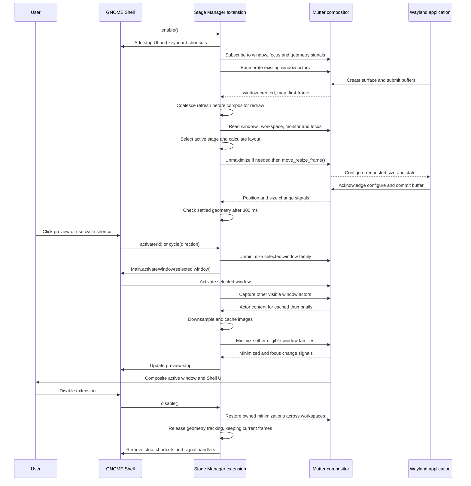

# Stage Manager interaction with GNOME Shell and Mutter on Wayland

The extension runs inside GNOME Shell and calls Mutter's window-management APIs
through GJS. The lifelines below are logical components: Shell, the extension,
and Mutter share a process; applications communicate with Mutter over Wayland.

## Implementation details

- **Previews:** visible windows use `Clutter.Clone`; before minimizing, the
  extension caches a reduced-size image. Hidden windows show that snapshot or
  an app icon.
- **Timing:** new windows wait for `first-frame`, with a 1.5-second fallback once
  an actor is available. Resizing is asynchronous; the 300 ms check handles
  windows that cannot accept the requested size.
- **Ownership:** cleanup restores windows minimized by the extension, preserving
  windows the user had already minimized. Explicit card selection may restore
  the selected root window. Independently minimized dialogs remain minimized.
- **Workspace switches:** retain managed frames, resize state, and owned
  minimizations on inactive workspaces. Reconcile the current workspace before
  compositor redraw rather than restoring original geometry on departure.
- **Suspension:** Overview hides the strip and pauses management without
  restoring windows. Its native picker includes minimized windows; reconcile
  selection and visibility when it starts closing, then reveal the strip once
  it is hidden. Lock/greeter mode restores owned minimizations and releases
  geometry tracking. Original frames and maximize states are not saved.
- **Scope:** management targets eligible windows on the active workspace and
  primary monitor. Newly mapped windows and windows with a pending resize are
  allowed to settle before they are minimized.

The diagram summarizes the normal path. Signal callbacks may run during API
calls, and Mutter's before-redraw callbacks coalesce subsequent refreshes. The application
exchange is a simplified native Wayland resize path; Mutter handles the
protocol exchange rather than the extension sending Wayland requests directly.

## Source references

- [Extension lifecycle and shortcuts](../extension.js)
- [Stage coordination and selection](../src/stageController.js)
- [Window tracking and first-frame handling](../src/windowTracker.js)
- [Window arrangement and geometry tracking](../src/windowArranger.js)
- [Minimization ownership](../src/minimizeLedger.js)
- [Preview actors and cached snapshots](../src/stagePreview.js)
- [Shell overlay strip](../src/stageStrip.js)
- [Mutter Meta.Window API](https://gnome.pages.gitlab.gnome.org/mutter/meta/class.Window.html)
- [Wayland surface lifecycle and buffer commits](https://wayland.freedesktop.org/docs/html/apa.html#protocol-spec-wl_surface)
